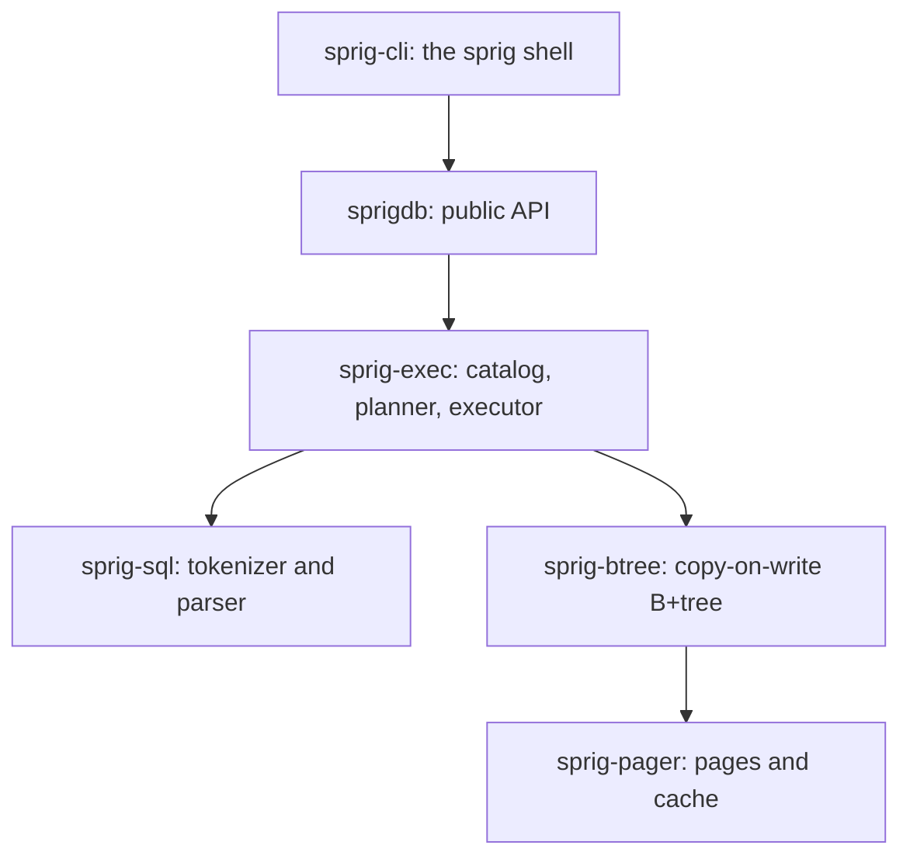

# sprigdb

A small, open-source, embedded SQL database written in Rust. It is one file
on disk, like SQLite. It has three goals:

1. **Safe for AI agents.** Agents work in branches. `BRANCH`, `DIFF`,
   `MERGE` and `DISCARD` are plain SQL.
2. **Easy to learn from.** You should be able to read the whole engine in a
   weekend. Each layer has a chapter in the book.
3. **Easy to use.** One install command, no config, no server.

> Status: Phase 0. Nothing works yet.

## Layout



| Crate | Job |
|---|---|
| `crates/sprig-pager` | Read and write 4 KB pages, with a cache |
| `crates/sprig-btree` | Copy-on-write B+tree, snapshots, branches |
| `crates/sprig-sql` | SQL text to AST |
| `crates/sprig-exec` | Catalog, planner, Volcano executor |
| `crates/sprigdb` | Public API |
| `crates/sprig-cli` | The `sprig` binary |

Start reading at the bottom (`sprig-pager`) and work up.

## Build

```bash
cargo build
cargo test
mdbook serve book   # the docs site, at http://127.0.0.1:3000
```

## License

Dual-licensed under [MIT](LICENSE-MIT) or [Apache-2.0](LICENSE-APACHE), at
your option.
